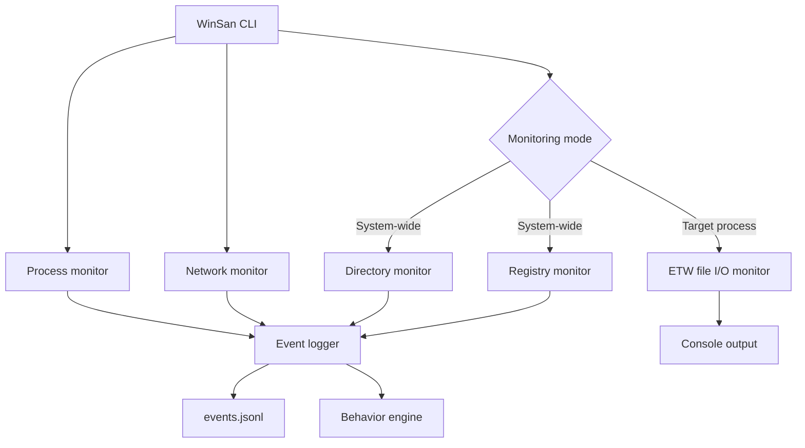

# WinSan — Windows Malware Behavior Monitor


## Overview

**WinSan** is a lightweight Windows behavior monitoring tool written in C++17 using native Windows APIs. It is designed for malware analysis, endpoint security research, and learning Windows internals through runtime telemetry.

WinSan observes process lifecycle events, filesystem changes, selected registry keys, and TCP connections. It supports system-wide monitoring and targeted observation of an executable, with structured JSON Lines logging for subsequent analysis.

> WinSan is an experimental monitoring tool, not an isolation sandbox, antivirus, or production EDR. It does not prevent malware from modifying the system.

## Features

- **Process monitoring:** Detect process creation and termination, collect PID, parent PID, executable name, image path, and SHA-256 hash.
- **Filesystem monitoring:** Observe creation, deletion, modification, and rename events recursively on the C: drive, with duplicate-event suppression and file metadata collection where available.
- **Targeted file I/O:** Use Event Tracing for Windows (ETW) to observe file-I/O event metadata associated with matching process IDs.
- **Registry monitoring:** Detect added, modified, and deleted values in selected HKCU keys, including startup persistence locations. Flag changes to startup values for investigation.
- **Network monitoring:** Observe newly detected IPv4 TCP connections, including owning PID, executable information, local and remote endpoints, and connection state.
- **SHA-256 hashing:** Calculate hashes of accessible executable images and files using Windows cryptographic APIs.
- **Process filtering:** Select an executable by name using command-line arguments.
- **Structured logging:** Append supported events to `events.jsonl` for offline analysis and potential SIEM ingestion.
- **Behavior engine:** Provides an initial event-processing hook for future detection and correlation logic.

## Architecture



## Monitoring modes

| Capability | System-wide | Target process |
| --- | --- | --- |
| Process lifecycle | Yes | Filtered by name |
| File activity | Directory notifications | PID-filtered ETW metadata |
| Registry activity | Selected HKCU keys | Disabled |
| IPv4 TCP connections | Yes | Filtered by process name |
| JSONL logging | Supported events | Process and network events |
| ETW file events in JSONL | Not applicable | Not yet implemented |

### Registry coverage

- `HKCU\Software\MiniSandbox`
- `HKCU\Software\Microsoft\Windows\CurrentVersion\Run`
- `HKCU\Software\Microsoft\Windows\CurrentVersion\RunOnce`

Startup registry changes are investigative signals, not proof of malicious activity.

## Technologies used

| Technology | Purpose |
| --- | --- |
| C++17 / STL | Core application and data structures |
| Win32 API / Tool Help API | Process enumeration and metadata |
| ReadDirectoryChangesW | Filesystem change notifications |
| Event Tracing for Windows (ETW) | Targeted file-I/O telemetry |
| Windows Registry API | Registry value monitoring |
| IP Helper API / Winsock | TCP connection enumeration |
| Windows CryptoAPI | SHA-256 hashing |
| JSON Lines | Structured event storage |
| C++ threads | Concurrent monitoring modules |

## Getting started

### Prerequisites

- Windows 10 or 11 recommended (compatibility across versions is not formally tested).
- Git and a C++17-capable Windows compiler, such as MinGW-w64 through MSYS2 UCRT64.
- Administrator privileges recommended, particularly for kernel ETW tracing.
- An isolated Windows virtual machine for security experiments.

### Clone the repository

```bash
git clone https://github.com/anushit-cybersec/WinSan.git
cd WinSan
```

### Build from source

Open an MSYS2 UCRT64 terminal. If needed, install the compiler:

```bash
pacman -S --needed mingw-w64-ucrt-x86_64-gcc
```

Suggested build command:

```bash
g++ -std=c++17 -O2 -pthread *.cpp -o monitor.exe -ladvapi32 -liphlpapi -lws2_32 -luuid
```

The command is based on the source modules and Windows API dependencies; it has not been independently build-tested for this revision. Prefer building from reviewed source rather than relying on the executable committed to the repository.

## Usage

Run the program from PowerShell, preferably in an elevated terminal when using ETW.

```powershell
# Display available options
.\monitor.exe --help

# Monitor general system activity
.\monitor.exe

# Monitor a specific process
.\monitor.exe --process notepad.exe

# Short form
.\monitor.exe -p curl.exe
```

| Option | Description |
| --- | --- |
| `-h`, `--help` | Display command-line help |
| `-p`, `--process <name>` | Select an executable to monitor |
| No arguments | Enable system-wide monitoring mode |

Press `Ctrl+C` to stop monitoring.

## Example workflow

1. Start WinSan in a Windows test VM using `--process notepad.exe`.
2. Open Notepad after the monitor starts.
3. Create and save a harmless text file, then close Notepad.
4. Review process lifecycle events and any ETW file-I/O metadata printed to the console.
5. Inspect `events.jsonl` for recorded process events.

## Event logging

Supported events are appended to `events.jsonl` in the current working directory. Each record includes fields such as timestamp, event type, PID, parent PID, name, path, size, SHA-256, local and remote IP addresses and ports, and connection state.

Illustrative event types:

| Category | Events |
| --- | --- |
| Process | `PROCESS_CREATED`, `PROCESS_TERMINATED` |
| File | `FILE_CREATED`, `FILE_MODIFIED`, `FILE_DELETED`, `FILE_RENAMED_FROM`, `FILE_RENAMED_TO` |
| Registry | `REGISTRY_VALUE_SET`, `REGISTRY_VALUE_CHANGED` |
| Network | `NETWORK_CONNECTION` |

Inspect recent records in PowerShell:

```powershell
Get-Content .\events.jsonl -Tail 10
```

The JSONL format can serve as an input for external analysis scripts or a separately configured Elastic Stack pipeline. No SIEM integration is bundled.

## Project structure

```text
WinSan/
├── main.cpp                 # CLI and process lifecycle monitoring
├── behavior_engine.cpp/.h   # Initial behavior analysis hook
├── file_monitor.cpp/.h      # Directory change monitoring
├── hash.cpp/.h              # SHA-256 hashing
├── logger.cpp/.h            # Structured event logging
├── network_monitor.cpp/.h   # TCP connection monitoring
├── process_filter.cpp/.h    # Executable name filtering
├── registry_monitor.cpp/.h  # Registry monitoring
├── target_file_etw.cpp/.h   # Targeted ETW file-I/O monitoring
├── target_process.cpp/.h    # Target PID lookup
├── utils.cpp/.h             # Shared utilities
├── events.json              # Existing event data
├── events.jsonl             # Event log
└── monitor.exe              # Committed executable
```

## Current limitations

- Process and network snapshot polling can miss short-lived activity.
- System-wide filesystem and registry events do not identify the responsible process.
- Targeted registry monitoring is disabled pending reliable attribution.
- Targeted ETW file-I/O output currently reports PID, event ID and opcode; it does not decode filenames or write those events to JSONL.
- Network monitoring covers selected IPv4 TCP states, not UDP, IPv6 or packet contents.
- The behavior engine currently reports received events rather than performing comprehensive malware classification.
- Registry value data is currently reused in the `sha256` field for certain registry events; consumers should interpret fields according to event type.
- Access restrictions, event volume and hashing overhead may reduce telemetry coverage.
- Logs may contain sensitive local paths, network endpoints and registry data. Review and sanitize them before sharing.

## Proposed roadmap

- [ ] Decode ETW file paths and operation details.
- [ ] Add targeted registry monitoring with reliable process attribution.
- [ ] Unify ETW events with structured event logging.
- [ ] Improve thread-safe logging and graceful shutdown.
- [ ] Implement behavior correlation and configurable detection rules.
- [ ] Add IPv6 and UDP visibility.
- [ ] Add process-tree tracking and analysis reports.
- [ ] Provide optional SIEM integration examples and automated tests.

## Intended use

WinSan is intended for defensive security research, malware-analysis education, Windows internals experimentation, and authorized endpoint monitoring.

Only monitor systems you own or have permission to analyze. Use a disposable, isolated VM when handling suspicious software, and avoid exposing host folders, credentials, or production networks to untrusted samples.

## Contributing

Bug reports, suggestions, documentation improvements, and defensive monitoring contributions are welcome through GitHub issues and pull requests.

## Author

**Anushit** — [GitHub: anushit-cybersec](https://github.com/anushit-cybersec)

## License

No license file was present in the repository at the time of documentation. Contact the repository owner for reuse and redistribution permissions.
